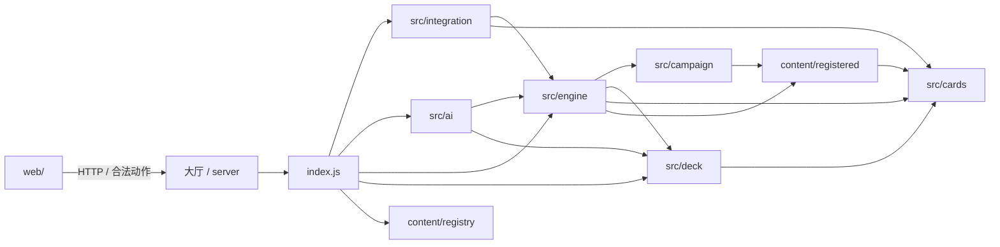

# Arkham Horror 模块架构

本文是 `games/arkhamhorror` 的唯一架构说明，覆盖目录职责、依赖方向、运行流程、内容扩展、测试与生成物管理。历史行动计划、阶段报告和界面评审已移出运行目录，不再作为当前实现依据。

## 1. 定位与当前边界

该目录实现大厅中的《诡镇奇谈：卡牌版》合作 Mod，包含服务端规则、战役内容、AI 上下文、浏览器界面和自动化验证。

- 规则版本：`n6.0`。
- 存档结构版本：`7`；版本不一致时拒绝静默续算。
- 内容契约版本：`1`。
- 《夜之狂热》状态为 `playable`，三关组成可启动战役。
- 《敦威治遗产》状态为 `playable`，八章组成可从大厅启动的完整战役；规则仍采用本 Mod 的简化实现边界。
- 《卡尔克萨之路》为 `playable`，沿用敦威治的卡包、章节、资源与验收目录契约；逐卡字面核对仍在迁移账本中跟踪。
- 《失落的时代》为 `playable`（账本 `earlyAccess`）：十章组成可从大厅启动的战役，序幕按补给品点数购买补给、幕间按卡面划掉补给；逐张卡面字面核对仍在 `audit/tfa-migration.json` 的 `remaining` 清单与 `confirmations.scenarios[].checks.literalCardBehavior` 下跟踪。
- 《万象无终》M0–M5 已交付（发布口径 `playable` + `earlyAccess`）：战役、9 章与 `tcuCampaign` 包可从大厅启动，`assertLaunchable` 通过；六位正式调查员可选人/可构筑，87 张玩家卡逐卡验收（85 张可构筑，83 张可入牌组进构筑界面与 TCU 战役起始牌组池；05314/05317 绑定副本与 2 张基础弱点只作依赖）。逐卡自动账本 `audit/tcu-all-card-acceptance.json` 377/377 verified；逐卡行为审计 `audit/tcu-card-behavior-audit.json` 在 2026-10-25 完成第七轮全量重跑（继续修复后重审 + 交叉复核 + Lead 裁决）：377 条记录 **363 match（登记已验收）/ 14 approximation / 0 gap**，因此 `equivalenceCertified: false`、14 条非 match 逐卡在总账 remaining 中，未宣称规则等价（已验收清单见 [docs/tcu-card-audit-round7.md](docs/tcu-card-audit-round7.md)；前几轮基线见 [round4](docs/tcu-card-audit-round4.md)、[round3](docs/tcu-card-audit-round3.md)）。发布级证据（大厅→序章→章节实机路径、媒体资源、展示素材与 27 首 BGM）见 [docs/tcu-release.md](docs/tcu-release.md)；逐章证据见 `audit/tcu-scenario-acceptance.json`，整轮账本见 `audit/tcu-migration.json`。
- 目录收录不等于规则已实现；可选人、可构筑和可启动状态必须经过服务端许可与内容注册表校验。

## 2. 目录结构

```text
games/arkhamhorror/
├─ index.js                 # Mod 唯一入口，大厅只依赖这里
├─ ARCHITECTURE.md          # 当前架构说明
├─ playwright.config.mjs    # 浏览器回归配置
├─ src/                     # 服务端领域与应用代码
│  ├─ ai/                   # AI 观察、剧情上下文、协作计划
│  ├─ campaign/             # 战役图、记录、经验、升级、剧情
│  ├─ cards/                # 卡牌目录、身份、效果和兼容数据
│  ├─ deck/                 # 可用性、构筑规则和牌组生成
│  ├─ engine/               # 权威状态机、动作、结算和混乱袋
│  └─ integration/          # 大厅策略、观察投影、展示投影、只读 API
├─ content/                 # 内容包、战役与关卡注册
├─ catalog/                 # 导入后的原始来源和字段溯源
├─ presentation/            # 卡图解析规则和媒体登记
├─ web/                     # 浏览器端 JS、CSS、字体、音频和图片
├─ tests/                   # Node、HTTP 与浏览器回归；统一 Node 入口
├─ tools/                   # 导入、审计、图像与发布工具
└─ audit/                   # 可复现的审计输入、基线和生成报告
```

运行目录不保存阶段计划、人工截图或临时存档。浏览器临时结果写入 `test-results/`，发布/人工检查产物写入仓库根目录的 `artifacts/`，两者都不是运行时输入。

## 3. 分层职责

### 3.1 Mod 入口

`index.js` 是大厅加载 Arkham 的唯一入口。它声明游戏元数据、设置、AI 协议、状态投影、资源目录和规则回调，但不实现具体卡牌或关卡规则。

入口负责组合以下能力：

- `src/integration/`：大厅会话、API 与观察者视图。
- `src/ai/`：模型决策和剧情聊天上下文。
- `src/engine/`：建局、合法动作、校验与执行。
- `src/deck/`：构筑面板数据。
- `content/`：战役列表及可启动状态。

入口另外声明两个与浏览器界面共享的约定：

- `viewState` / `viewEvents` / `staticTables`：观察者投影（见 `src/integration/observation.js`）。
- `autoPassChoice`：自动跳过的房主侧代答钩子。客户端在 move 的 `body.client.autoPass` 里带上本机
  「反应关」的卡号集合，并用联机 `prefs` 命令在开关变化/进局/重连时全量同步；大厅按座位缓存后，
  在命令的发布之前调用它，把返回的普通 `choose/skip` 交给 `commitMove` 提交（与玩家手点同一条路径，
  回放/撤销/审计不变）。P1 起缓存覆盖任意在线座位，所以别人命令触发的窗口、多座位连续窗口也能在
  同一条命令里代答；离线座位不代答。判定函数 `reactionSkipPlan` 放在 `web/reaction-preferences.js`，
  浏览器与 Node 共用同一份映射逻辑（Node 反向 import `web/` 是架构守卫允许的方向）。

### 3.2 权威规则引擎

`src/engine/engine.js` 是权威状态机。所有客户端、AI 和 HTTP 请求都必须提交它公开的动作，并依次通过 `legalMoves`、`validateMove` 和 `applyMove`。浏览器不能直接修改状态。

同目录其余模块分担稳定的规则原语：

- `rules-state.js`：规则/存档版本、确定性随机数、实例编号和通用数值。
- `resolution.js`：可暂停、可恢复的选择事务；待决选择只允许指定座位回答。
- `effects.js`：声明式卡牌效果解释。
- `chaos-bag.js`：混乱袋初始化、抽取、封印、归还与检定生命周期。
- `ability.js`：**声明式能力层**。卡片只导出描述子（`kind` / `trigger` / `criteria` / `target` / `cost` / `limit` / `resolve`），引擎按窗口枚举、按成本校验、按上限记账；描述子不直接改状态，只通过 `ctx.api` 的窄接口结算。`kind` 共 11 种，其中五个是生命周期钩子（`played`/`commit`/`weakness`/`entersPlay`/`leavesPlay`）。条目另有 `scope`（`card`/`investigator` + 敌人/地点/幕/议程/剧情支援/威胁六种非玩家通道，Phase 3 · D1），非玩家条目由引擎按「场上实体」枚举，数值与布尔规则读 `modifiers.js` 的 `entityModifierTotal`/`entityRuleActive`。
- `windows.js`：**时机窗口注册表**。窗口 id、中文标签、`interrupt/reaction/player` 三类语义、以及"每次触发"实例键集中在这里；新增窗口必须同时补调用点与测试。
- `matcher.js`：目标查询组合子（`all/any/none`、`ownSeat`、`atTrait`、`contextEnemy`，以及打出条件用的 `ownTurn`/`clueAtLocation`/`noEnemiesHere` 等），用于描述子的 `criteria` 与 `playCondition`，替代散落的 filter 链。
- `targets.js`：**目标枚举（B1）**。描述子声明 `target: { kind, query, optional }` 后，`legalMoves` 按候选展开成逐目标行动，`validateMove` 用同一份枚举校验，`ctx.target` 注入实体；5 种 kind（enemy/investigator/location/asset/cardInHand），query 只能收窄默认范围。
- `modifiers.js`：**修正管线**。声明式修正（技能值、生命/理智上限、手牌上限、槽位、打出费用、敌人生命）先于旧式 `passive` 字段结算；旧字段由 `legacyStatDelta` 桥接，逐张迁移后删除。持续效果的修正由引擎注入 `activeEffects` 读点（本模块不 import effect-state）。
- `effect-state.js`：**持续效果实体（A1）**。`state.effects[]`（6 种 `duration`）、`expireEffects(state, timing)` 统一过期、来源绑定清理与效果能力枚举；记录必须是纯 JSON（能力只能写 `effect` 数据，不能写 `resolve`）。
- `lifecycle.js`：**生命周期读点**。事件打出（`playedEffect`）、投入检定（`commitProfile`）、弱点揭示（`weaknessProfile`）、进场/离场（`entersPlayEffect`/`leavesPlayEffect`）只从这里取行为数据：描述子优先，缺失时回落到 `EFFECTS`，因此迁移一张卡不需要改引擎。
- `play-condition.js`：**打出条件单一读点**。描述子的 `playCondition` 与旧 DSL 的 10 个可用性字段（`ownTurnOnly`/`requiresClueAtLocation`/`playableFromDiscard`…）都在这里翻译成 matcher predicate 并给出原文案；`playAccess()` 统一区域/类型许可。
- `replay.js`：**对局日志与重放（Phase 4）**。`state.actionLog` 记录每个成功动作（纯 JSON，随存档往返）；`stateHash` 是稳定指纹（键排序、排除派生资源与瞬时字段，`STATE_HASH_VERSION` 见模块头）；`captureReplayLog` / `replayLog(log, { until, observe })` / `replayHashes` 支撑迁移安全网与存档回放；`verifyReplay` / `stateDiff` 给出路径级差异；`rewindTo` / `undoMoves` 是撤销地基（截断日志后重放）。golden 基线与迁移对比工具见 §5.3，描述子/模型规格见 [`docs/card-model.md`](docs/card-model.md)。
- `cost.js`：**费用表达式（C3，Phase 2）**。`cost` 字段可以是数字、函数或声明式表达式（`per/amount/offset/min/max/filter/x`）；`normalizeCostValues` 是一份求值器，行动文案预览、`canAffordAbility` 校验、`payAbilityCost` 扣费三处共用，求值失败按"付不起"处理。
- `limits.js`：**上限作用域与归属（C4，Phase 2）**。`limit: { scope, owner, count }`：10 种 scope（含 `perWindow/perAttack/perSearch/perAction/perCampaign`）、4 种 owner（`instance/investigator/player/group`）；记账仍是 `state.abilityLimits` 的纯 JSON，旧字符串写法自动映射。
- `test-result.js`：**检定结果契约（B3，Phase 2）**。阶段词表（beforeCommit/afterCommit/tokens/results）+ 标准结果形状；`performTest().summary`、`state.lastTestResult`、窗口 `ctx.result` 与 `api.retryTest`/`api.commitCards` 共用同一份数据。
- `look.js`：**看牌与检索（B5，Phase 2）**。看顶 N 张/排列/放回顶底洗回、看弃牌堆、搜索整副牌库的选项形状与校验；真正的读写走引擎的 `lookAt()`/`searchDeck()`（随机与询问必须经过事务，才能重放）。
- `zones.js`：**区域与牌的去向（B6，Phase 2）**。`hand / deckTop / deckBottom / discard / play / threat / attached / beneath / setAside / removedFromGame / victoryDisplay` 的词表与移动规格校验；搬动由引擎的 `moveCardTo()` 执行（场上卡离开仍走 `leaveAsset`，离场钩子照旧）。

执行动作必须保持原子性：校验失败、错误回答者、过期版本或结算异常都不能留下部分状态修改。

#### 3.2.1 能力层的最小约定

1. **新增一张卡**：玩家卡写 `src/cards/entries/<code>.js`；非玩家卡写 `src/cards/encounter-entries/` 下按归属落点的单卡文件（通用 / 战役共用 / 关卡专用，见 §3.3）。不要修改 `engine.js`。
2. **描述子不可变**：注册时规范化并冻结；运行期数据一律写入 `state`。
3. **注册即校验**：未知 `kind`、缺 `trigger`、缺 payload、未知字段、重复注册都会在模块加载时抛错，而不是在对局中途静默失效。
4. **能力与效果同形**：`kind: 'action' | 'free'` 的描述子会折叠成旧式 ability 形状，因此 `legalMoves`、牌桌按钮、`doAbility`、`playerWindow` 只有一套枚举。
5. **上限与费用**：`limit` 支持旧字符串（`oncePerTest/Phase/Round/Turn/Game`）与 Phase 2 的对象形式 `{ scope, owner, count }`（scope 另有 `perWindow/perAttack/perSearch/perAction/perCampaign`，owner 有 `instance/investigator/player/group`），记账在 `state.abilityLimits`（`{ used, round, phase, turn }`）；费用支持数字、函数与声明式表达式（`cost.js` 统一求值），先整体校验再扣费，`legalMoves`/`validateMove`/预览三处同源。**上限的展示侧**：用掉的能力会从 `legalMoves` 消失，所以 `abilityUsage(state, inv)` 把每张支援的受限能力投影成 `view.abilityUsage`（卡面「已用」角标、动作面板置灰行、卡牌详情、AI 提示共用同一份账）；卡面之外的「每场游戏一次」行动（地点/剧本）由内容层在提示上同时给 `reason` 与 `used: true`，观察投影收进 `view.usedActions`，牌桌在地点详情与动作栏显示「已用」，AI 在「暂时不可执行的卡面行动」段读到原因。
6. **窗口必须已注册**：能力层打开的窗口都会进 `windows.js`；未注册 id 会被记录并可由测试断言发现漂移。
7. **目标先声明再执行**：需要选目标的能力写 `target: { kind, query, optional }`，不要在 `resolve()` 里再问一轮；`legalMoves`/`validateMove`/`ctx.target` 都读同一份枚举。
8. **打出条件写 `playCondition`**：不要新增 `ownTurnOnly` 之类的散字段；旧字段由 `play-condition.js` 收敛。
9. **持续效果用 `api.addEffect`**：时长写进 `duration`，由统一过期点清理；效果记录必须纯 JSON（能力只能写 `effect` 数据，不能写 `resolve`）。
10. **布尔/授予写修正，不写引擎字段**：`capability:<id>` / `ignore:<id>`（C1）与 `add:trait|keyword|slot|skillIcon`（C2）都是修正目标，读点在 `modifiers.js`；声明了但没接线的 id 在注册期报错。

### 3.3 卡牌与构筑

`src/cards/` 保存“卡是什么”和“已实现哪些行为”：

- `cards-data.js` 是导入工具生成的完整目录，不手工编辑。
- `card-effects.js` 保留调查员数据表（`INVESTIGATOR_ABILITIES`）；`EFFECTS` 已清空，不再是行为入口。
- **`entries/<code>.js` 是一张卡一个文件的行为落点**（2026-10 起）：每个文件 `export default` 一个描述子条目，按需 import `entries/_shared.js` 与 `engine/matcher.js`。命名 = 卡号；条目 `code` 必须与文件名一致。新增卡用 `node tools/scaffold-card.mjs <code> --entry`。`entries/` 只放玩家卡。
- `entries/index.js` 是**生成物**：静态 import 全部单卡文件，保持旧 `byCode` 的首次出现顺序。改/增/删卡文件后必须运行 `node tools/build-card-index.mjs --write`。
- **非玩家条目同样一卡一文件**，统一放在 `src/cards/encounter-entries/`（2026-10 起）：
  - `shared/<encounterGroup>/<code>.js`：跨战役复用的通用遭遇组卡；
  - `<campaign>/_shared/<encounterGroup>/<code>.js`：同一战役内跨关卡复用；
  - `<campaign>/<scenario>/<code>.js`：关卡专用（地点/幕/议程/专属敌人/诡计/剧情资产）。
  归属按「这张卡在几个关卡/战役的 `definition.js` 与 manifest zones 里出现」判定，别名条目跟随同名印刷卡；不得按 scope 建 `enemies.js` / `treacheries.js` 之类的大文件，也不得把多个关卡塞进同一个目录。
- `encounter-entries/index.js` 是**生成物**：静态 import 全部分类文件，保持拆分前 `NON_PLAYER_ABILITY_ENTRIES` 的顺序；改/增/删非玩家条目后运行 `node tools/build-encounter-index.mjs --write`。
- `encounter-abilities.js` 只做**兼容聚合（facade）**：导出 `NON_PLAYER_ABILITY_ENTRIES` / `NON_PLAYER_ABILITY_CODES` / `nonPlayerEntryFor` 等旧读点，不存放条目。新增敌人/地点/幕/议程规则写单卡文件，禁止再往 facade 追加。
- `encounter-entries/_lookup.js` 是跨条目查询的唯一读点：`index.js` 求值完成后把条目列表注册进来，查询在运行时惰性建表，避免 `entry → _lookup → index → entry` 的 ESM 循环在单独 import 条目时踩 TDZ；条目之间不得互相直接 import。
- `entry` 文件的硬约束：不 import `engine.js` / `card-abilities.js` / `encounter-abilities.js` / 批次文件 / `content/`；只通过描述子与 `ctx.api` 结算。守卫见 `tests/card-entries.test.mjs` 与 `tests/encounter-entries.test.mjs`。
- `card-abilities.js` 只做聚合：导出 `CARD_ABILITY_ENTRIES` / `CARD_ABILITY_CODES` / `PHASE5_MIGRATED_CODES`，**不再放条目**。
- `ability-migration-batches.js` 已删除；`audit/migration-batches.json` 只保留“哪张卡属于哪一批”的账本。**不得恢复** `BATCH_*` / `MIGRATED_*` 数组。
- 完整流程、agent 一次执行清单与拆分证据见 [`docs/card-entry-files.md`](docs/card-entry-files.md)；非玩家条目拆分的扫描、归属算法与对账记录见 [`docs/encounter-entry-split-plan.md`](docs/encounter-entry-split-plan.md)；整轮扩展的迁移顺序（扫描机制 → 拆分原语 → 关键字/规则书 → 交互 → 多子进程批量卡牌 → 验收）见 [`docs/arkham-content-migration.md`](docs/arkham-content-migration.md) §4。
- `card-identity.js` 统一运行时别名、原卡号和双面身份。
- `card-catalog.js` 组合目录、来源、图片和开放状态，供只读图鉴 API 使用。
- `scenarios-data.js` 是旧调用方的兼容导出；新关卡应从 `content/registered.js` 注册。
- `core-acceptance.js` 由行为审计工具生成，表示已有证据范围，不表示穷举所有组合。

`src/deck/` 保存“谁能用什么牌”：

- `availability.js` 控制调查员、卡牌和内容包是否开放。
- `deck-rules.js` 复用浏览器与服务端共享的声明式规则。
- `deckbuilding.js` 负责合法性、自动构筑、评分和升级候选。

任何新卡都需要分别考虑目录数据、开放许可、行为实现和测试证据；仅增加目录记录不会自动进入牌组。

### 3.4 战役与内容注册

`src/campaign/` 处理跨关状态：

- `campaign-flow.js` 解释战役节点图与路线条件。
- `campaign.js` 处理人物登记、经验、创伤、卡组变化和关间升级。
- `campaign-effects.js` 应用结算奖励、混乱袋变化和幸存者选择。
- `story.js` 投影已到达的引言、结局与冒险日志，不泄露未触发分支。

`content/` 是可插拔内容层：

- `schema.js` 定义卡包、战役、关卡和状态契约。
- `migration-confirmation.js` 校验扩展循环的剧本、关键词和规则书迁移确认；通用流程见 `docs/arkham-content-migration.md`。
- `registry.js` 提供注册、查询、依赖校验及大厅投影。
- `registered.js` 是正式装配点。
- `packs/` 保存卡包清单和扩展效果。
- `campaigns/<campaign>/` 保存战役清单、共享数据、关卡定义、布局与行为。

新增关卡时，应在目标战役清单中声明顺序/解锁条件，在独立关卡目录提供定义、布局、行为和入口，最后通过 `registered.js` 注册。不得在引擎或大厅中增加按关卡名称判断的分支。

关卡的**布置、推进常量与结局结果优先声明**：`content/scenario-declaration.js` 的 `declareScenario({ id, setup, data, hooks })` 把起始地点、地点清单/随机变体、开局敌人与遭遇牌库修改写成数据，`hooks` 只保留真正需要脚本的部分（`actions`/`describe`/`resolution` 等）。结局的记录/创伤/经验可以写成 `resolution` 返回的 `effects[]` 条目，由 `applyResolutionResults` 统一结算并按 `campaign.recordSchema` 校验类型。

### 3.5 集成、观察与展示

`src/integration/` 是领域层与大厅/浏览器之间的边界：

- `hall-integration.js` 定义会话策略、存档摘要和参与者描述。
- `observation.js` 根据观察者座位裁剪手牌、牌库、待决选项等私有信息。
- `presentation-state.js` 把权威状态转换为稳定的牌桌展示数据。
- `web-api.js` 提供只读图鉴 API，并根据目录与前端实现计算资源版本。

`presentation/` 只处理媒体选择和卡图回退；`web/` 只处理交互与渲染。前端提交服务端已经公开的合法动作，不复制规则判定。反馈弹窗属于大厅能力（`createUI(host)` 注入的 `openFeedback()`），`web/` 只在战役局外页和牌桌标题栏放入口，不重复实现表单。

**卡牌承载区**（牌离开手牌/牌库、仍附着在支援、调查员或地点上）是这条边界上最容易漏的一段：
`asset.attached` / `attachedCards` / `attachments`、`inv.beneath`、`inv.hunchDeck`+`hunchRevealed`、
地点附属与 `state.bondedSets` 必须同时被 `engine/card-defs.js`（卡面表）、`integration/observation.js`
（按座位投影）与 `web/`（显示与打出入口）覆盖。新增一种承载区时这三处一起改，并在
[`docs/card-model.md`](docs/card-model.md) §7.1 登记；否则症状是读档后卡名退化成卡号，
或牌在桌上却没有任何可点的动作（回归见 `tests/cards-under-ui.test.mjs` / `tests/cards-under.browser.mjs`）。

## 4. 依赖方向



约束如下：

1. 大厅代码只加载 `index.js`，不直接依赖 Arkham 内部模块。
2. `web/` 不导入服务端规则引擎；共享的纯构筑规则放在 `web/deck-rules.js`，由 `src/deck/deck-rules.js` 转出。
3. `content/` 可以使用稳定的卡牌、状态和战役契约，但不依赖大厅或 DOM。
4. `src/engine/` 不依赖浏览器实现或测试夹具。
5. `audit/` 与 `catalog/` 是数据/证据，不得反向成为通用业务逻辑。
6. 能力层内部方向固定：`card-abilities.js` → `ability.js`/`targets.js`/`play-condition.js`/`modifiers.js`/`matcher.js`/`windows.js`；`modifiers.js` 与 `ability.js` 互不 import（引擎通过 `setModifierRegistry` 注入注册表、通过 `setModifierHooks` 注入修正读点数，包括 `state.effects` 的 `activeEffects`）；`engine.js` 是唯一的装配点。
7. 状态模块方向：`rules-state.js` ← `effect-state.js` ← `engine.js`；`effect-state.js` 可以依赖 `windows.js`（trigger 规范化），但不依赖 `engine.js`；`save-migration.js` 通过 `engine.js` 暴露的入口迁移，不反向被引擎 import。

## 5. 运行流程

### 5.1 建局与跨关状态

```text
campaignHub
  → scenarioSetup
  → inScenario
  → scenarioResult
  → interlude
  → scenarioSetup（下一关）
  → campaignResult
```

状态只能通过合法动作迁移。关卡结算先固化结果、经验、创伤和战役记录，再进入关间；升级确认后才允许下一关继承新牌组。

### 5.2 一次动作请求

```text
客户端或 AI 读取观察投影
  → 从 legalMoves 选择动作
  → validateMove 校验座位、版本、时机、目标与费用
  → applyMove 在事务副本中执行
  → resolution 处理待决选择/恢复点
  → 成功后提交权威状态并增加 revision
  → observation 按座位重新投影
  → presentation-state 生成演出数据
```

AI 看到的上下文同样来自观察投影和合法动作，不得读取其他座位手牌、牌库顺序或未触发剧情。

### 5.3 重放、撤销与迁移对比

权威状态每次成功 `applyMove` 都会把 `{ seat, move }` 追加到 `state.actionLog`（纯 JSON、随存档往返）。由此得到一条纯函数链路：

```text
state.actionLog + 建局参数（state.setup / seed / difficulty / rulesMode / aiStoryAwareness / cardPoolScope / allowRollback / seatInvestigators）
  → captureReplayLog(state)
  → replayLog(log, { until })            # 纯函数：只依赖日志，不读外部状态
  → stateHash / replayHashes             # 键排序指纹，排除派生资源与瞬时字段
```

- **迁移对比**：`tools/replay-fixtures.mjs --baseline <文件>` 采集迁移前基线，改完代码用 `--compare <文件>` 逐条比较逐步指纹；输出"行为零变化"才算过。流程见 §5.3。
- **golden replay**：`tests/fixtures/replay/golden-replays.json` 固化 13 局真实对局（4 战役 / 5 关卡 / 786 步 / 799 个逐步指纹），`tests/replay-golden.test.mjs` 在 `fast` tier 校验；`npm run replay:fixtures` 是同一份基线的命令行校验。
- **撤销地基**：`rewindTo(state, until)` / `undoMoves(state, count)` 截断日志后重放并原地替换状态，保留检查点分支的 `revision` 偏移；交互入口（大厅 UI）尚未实现。
- **两条实现约束**：日志由 `applyMove` 在事务外持有（事务快照会重建状态，`dynamicState` 已排除 `actionLog`）；`continuation.move` 只保留语义字段（`resolution.js` 的 `cloneMove`），展示文案不参与指纹。

任何新的状态变化都必须能落在这条链路上：随机只走 `randomValue(state)`，询问只走 `requestChoice`，否则重放会漂移。

## 6. 数据与生成物

以下文件由工具生成或校验，修改源数据/实现后应运行对应命令，不要手工修补结果：

| 目标 | 来源/工具 | 命令 |
| --- | --- | --- |
| `src/cards/cards-data.js`、`catalog/`、`audit/catalog-report.json` | 多语言卡表与来源合并 | `npm run import` |
| `presentation/*.json`、`audit/presentation-report.json` | 图片规则与参考媒体 | `npm run presentation:write` |
| `audit/core-acceptance.json`、`src/cards/core-acceptance.js` | Core 行为测试 | `npm run test:core`（检查） |
| `audit/ability-coverage.json`、`audit/ability-migration.json` | 能力层覆盖度与迁移工作单 | `npm run cards:audit:write` |
| `audit/ability-workorder.json` | 166 个引擎码的形态与能力缺口分类 | `npm run cards:workorder:write` |
| `audit/card-code-whitelist.json`、`audit/effects-whitelist.json` | 冻结基线（只减不增，由同一工具维护） | `npm run cards:audit:write` |
| `src/cards/entries/index.js` | 单卡行为文件目录 → 静态索引（运行时不做目录扫描） | `npm run cards:index` |
| `src/cards/phase5-codes.js` | 旧 `PHASE5_MIGRATED_CODES` 的成员关系（一次性生成，Set 内容不要按文件顺序重排） | 手工维护 |
| `audit/migration-batches.json` | 迁移批次账本（“哪张卡属于哪一批”，不是行为存放处） | `npm run cards:migrate -- --batch <名> …` |
| `audit/core-acceptance.json`、`audit/carcosa-*-acceptance.json`、`audit/dunwich-acceptance.json` 里的证据文件哈希 | 验收测试文件改动后重算（证据映射不变） | `node tools/rehash-acceptance.mjs --write` |
| `tests/fixtures/replay/golden-replays.json` | golden replay 基线（真实对局的动作日志 + 逐步指纹） | `npm run replay:fixtures:write` |
| `audit/p6-behavior-ledger.*` | P6 行为证据 | `npm run audit:p6:write` |
| `audit/tcu-player-acceptance.json`、`src/cards/tcu-player-acceptance.js` | P7（M2）玩家卡逐卡验收证据与运行时 verified 集合（`--check` 逐字节复算） | `node tools/audit-tcu-player.mjs --write` |
| `audit/tcu-scenario-acceptance.json` | P8（M3）9 章逐章 12 项验收证据（实跑章节测试 + 内容计算 + 文件哈希；`--check` 逐字节复算） | `node tools/audit-tcu-scenarios.mjs --write` |
| `audit/tcu-scenario-source-lock.json` | P8 参考实现来源锁（9 章 Scenario 文件与战役共享文件 SHA-256） | `node develop/gen-tcu-source-lock.mjs` |
| 图片库存与摘要 | 本地图片库 | `npm run images:verify` |

`audit/resource-report.json` 是历史冻结基线，不能因为目录整理而重写成新的历史。报告中的旧路径属于当时证据快照；当前结构以本文和现有源码为准。

## 7. 测试结构

- `tests/node-suite.mjs` 是全部 Node/HTTP 回归的统一入口；不再按 N1、N2、N3、N4 保存重复套件壳。
- `*.test.mjs` 覆盖规则、内容、AI、审计和 HTTP 边界。
- `*.browser.mjs` 由 `playwright.config.mjs` 发现，覆盖真实界面、交互、尺寸和演出。
- `tests/fixtures/` 保存可复用的最小状态与剧情夹具；`tests/fixtures/replay/` 是 golden replay 基线（动作日志 + 逐步指纹，由 `npm run replay:fixtures:write` 生成，不要手改）。
- `tests/*-snapshots/` 保存需要人工确认的稳定视觉基线。

重放相关的分层（详见 §5.3）：

| 用例 | tier | 作用 |
| --- | --- | --- |
| `replay.test.mjs` | fast | 日志/指纹/重放/撤销的契约，含 4 局随机走子与建局参数完整性 |
| `replay-golden.test.mjs` | fast | 13 局真实对局重放出 799 个相同逐步指纹 |
| `replay-fuzz.test.mjs` | slow | 随机对局逐步一致（默认 40 局；REPLAY_FUZZ_FULL=1 跑 100 局） |
| `replay-fuzz-walker.test.mjs` | slow | 随机走子器状态不变量 / JSON 幂等 / 关键步重放（默认 400 步；FULL=2,000 步） |

常用命令（在 `games/arkhamhorror/` 下运行；在大厅根目录可加 `-w games/arkhamhorror`）：

```powershell
npm test
npm run test:browser
npm run test:dunwich
npm run test:ai
npm run import:check
npm run presentation:check
npm run replay:fixtures          # 校验 golden replay 基线
npm run replay:fixtures:write    # 行为有意变化后重采基线
```

本目录是独立的 git 仓库，按需克隆到大厅的 `games/arkhamhorror`（大厅不跟踪本目录的内容）。`tests/node-suite.mjs` 含 HTTP 回归，
与浏览器、P7 回归一样会加载大厅的 `lib/server.js`，因此需要在大厅目录内运行。

测试运行产生的 `test-results/` 可以随时清理；它不是测试输入。证据报告只有在对应生成器、来源和审核范围明确时才能更新。

## 8. 修改约定

1. 新功能先选择所属层，不在 `index.js` 或 `engine.js` 旁新增未分类文件。
2. 新关卡优先扩展内容注册表和关卡行为，不在通用引擎写名称分支。
3. 新卡牌先登记数据与开放条件，再实现行为；未知机制默认阻断，而不是近似放行。
4. **新卡牌行为写在 `src/cards/entries/<code>.js` 的单卡文件里**（能力/修正/旧印），并在同一次改动里运行 `node tools/build-card-index.mjs --write`。不得在 `engine.js` 按卡号新增分支，也不得恢复 `card-abilities.js` 条目或批次大文件；确实需要新机制时，先扩 `ability.js` 的通用能力，再补窗口与测试。流程见 [`docs/card-entry-files.md`](docs/card-entry-files.md)。
5. 任何状态变化都必须能由合法动作重放，并在 JSON 保存/恢复后得到一致结果。
6. 新观察字段先判断隐私级别；私有候选、手牌和内部续执行数据不得进入其他座位投影。
7. 浏览器只负责表达和提交，不把前端判断当作安全边界。
8. 临时分析、截图、执行日志和阶段总结写入根目录 `artifacts/`，不回填到运行目录。
9. 架构演进（重构、加卡、迁移）的决策依据是本文 §3–§8 与 [`docs/arkham-content-migration.md`](docs/arkham-content-migration.md)：本文定义稳态架构条文与演进规矩，内容迁移规范定义六步顺序与阶段判据。

## 9. 演进规矩（重构期摘要）

重构期间的目标形态是"五件唯一"。原重构路线文档已在 2026-10 的重构收尾后删除；现行条文见本文 §3–§8 与
[`docs/arkham-content-migration.md`](docs/arkham-content-migration.md)，此处只保留不可协商的部分。

| # | 唯一 | 目标 |
| --- | --- | --- |
| 1 | 行为入口 | 全部走 `src/cards/entries/<code>.js` 的单卡描述子（含生命周期钩子）；`card-abilities.js` 只聚合，不再新增 `EFFECTS` 条目 |
| 2 | 读点 | 引擎只经 `ability.js` 注册表枚举行为，不读 `EFFECTS` |
| 3 | 账本 | 一张 `audit/ability-coverage.json` 记录每张卡的通道、证据与缺口 |
| 4 | 内容分层 | 卡=数据+描述子；关卡=声明式定义+少数钩子；战役=声明式记录 |
| 5 | 守卫 | CI 冻结卡号集合、`EFFECTS` 键集合与描述子枚举，只减不增 |

硬规矩（细节与反例见路线文档 §3、§7）：

1. 新增卡牌行为只写单卡描述子（`entries/<code>.js`）；引擎不得按卡号、关卡名或战役名分支。需要新机制时先扩通用能力（`ability.js`/`windows.js`/`matcher.js`/`modifiers.js`/`targets.js`/`play-condition.js`/`effect-state.js`），再写卡。
2. 内容层不 import 引擎装配点；`engine.js` 是唯一装配点，`modifiers.js` 与 `ability.js` 互不 import。
3. 描述子在注册时规范化并冻结；运行期数据一律写 `state`，效果只经 `ctx.api` 结算；持续效果一律 `api.addEffect`（`state.effects[]`，纯 JSON）。
4. 规则层不读"谁在操作这个座位"这类策略；可选反应的自动跳过由大厅注入。
5. 状态变化必须能由合法动作重放，并在 JSON 存读档后一致；简化与近似实现必须显式标记，不得静默放行。

演进主指标（单调下降，由守卫测试校验）：

| 指标 | 当前 | 目标 |
| --- | --- | --- |
| `engine.js` 卡号字面量 | 166（103 个是行为分支） | 0 |
| `EFFECTS` 行为条目 | 385 | 0 |
| 卡牌顶层字段 | 69 | ≤10 组 |
| 战役逃生原语卡 | 93 | 0 |
| 描述子 `kind` | 11（含 5 个生命周期钩子） | ≤11 |
| 非玩家卡带 `abilities` 的条目 | 20（敌人 14 / 地点 6；另有 509 条为规则/修正条目） | 逐批 + |
| `behavior.js` 总行数 | 14,831（Phase 3 基线） | 只减不增 |

这四行由 `npm run cards:audit` 从 `audit/ability-coverage.json` 重算；`tests/architecture-guard.test.mjs`
在 `fast` tier 里守住白名单与产物同步——新增引擎卡号分支或新 `EFFECTS` 条目会让守卫失败，
必须先评审再放行。改动指标后运行 `npm run cards:audit:write` 并随迁移一起提交 diff。
`npm run cards:workorder` 则把 180 个码分成"标识引用 / 数据表 / 行为分支"，避免把文案标签当规则债务。

内容迁移（接新战役、新卡包）还必须满足 [`docs/arkham-content-migration.md`](docs/arkham-content-migration.md) 的确认门槛；两侧口径冲突时，以本文的分层约束为准。


