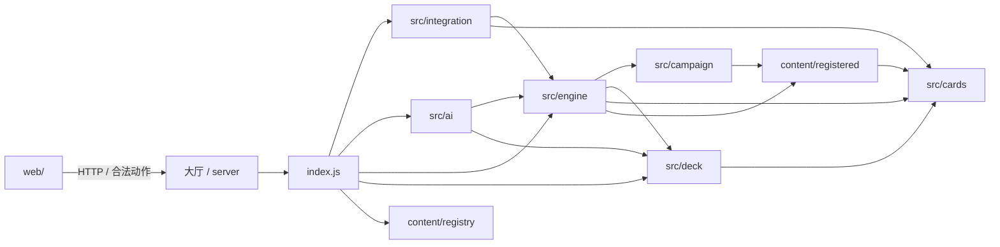

# Arkham Horror 模块架构

本文是 `games/arkhamhorror` 的唯一架构说明，覆盖目录职责、依赖方向、运行流程、内容扩展、测试与生成物管理。历史行动计划、阶段报告和界面评审已移出运行目录，不再作为当前实现依据。

## 1. 定位与当前边界

该目录实现大厅中的《诡镇奇谈：卡牌版》合作 Mod，包含服务端规则、战役内容、AI 上下文、浏览器界面和自动化验证。

- 规则版本：`n5.2`。
- 存档结构版本：`6`；版本不一致时拒绝静默续算。
- 内容契约版本：`1`。
- 《夜之狂热》状态为 `playable`，三关组成可启动战役。
- 《敦威治遗产》状态为 `playable`，八章组成可从大厅启动的完整战役；规则仍采用本 Mod 的简化实现边界。
- 《卡尔克萨之路》处于 `catalog-only` 迁移阶段；沿用敦威治的卡包、章节、资源与验收目录契约，尚不可启动。
- 目录收录不等于规则已实现；可选人、可构筑和可启动状态必须经过服务端许可与内容注册表校验。

## 2. 目录结构

```text
games/arkhamhorror/
├─ index.js                 # Mod 唯一入口，大厅只依赖这里
├─ ARCHITECTURE.md          # 当前架构说明
├─ playwright.config.mjs    # 浏览器回归配置
├─ src/                     # 服务端领域与应用代码
│  ├─ ai/                   # AI 观察、剧情上下文、协作计划
│  ├─ campaign/             # 战役图、记录、经验、升级、剧情
│  ├─ cards/                # 卡牌目录、身份、效果和兼容数据
│  ├─ deck/                 # 可用性、构筑规则和牌组生成
│  ├─ engine/               # 权威状态机、动作、结算和混乱袋
│  └─ integration/          # 大厅策略、观察投影、展示投影、只读 API
├─ content/                 # 内容包、战役与关卡注册
├─ catalog/                 # 导入后的原始来源和字段溯源
├─ presentation/            # 卡图解析规则和媒体登记
├─ web/                     # 浏览器端 JS、CSS、字体、音频和图片
├─ tests/                   # Node、HTTP 与浏览器回归；统一 Node 入口
├─ tools/                   # 导入、审计、图像与发布工具
└─ audit/                   # 可复现的审计输入、基线和生成报告
```

运行目录不保存阶段计划、人工截图或临时存档。浏览器临时结果写入 `test-results/`，发布/人工检查产物写入仓库根目录的 `artifacts/`，两者都不是运行时输入。

## 3. 分层职责

### 3.1 Mod 入口

`index.js` 是大厅加载 Arkham 的唯一入口。它声明游戏元数据、设置、AI 协议、状态投影、资源目录和规则回调，但不实现具体卡牌或关卡规则。

入口负责组合以下能力：

- `src/integration/`：大厅会话、API 与观察者视图。
- `src/ai/`：模型决策和剧情聊天上下文。
- `src/engine/`：建局、合法动作、校验与执行。
- `src/deck/`：构筑面板数据。
- `content/`：战役列表及可启动状态。

### 3.2 权威规则引擎

`src/engine/engine.js` 是权威状态机。所有客户端、AI 和 HTTP 请求都必须提交它公开的动作，并依次通过 `legalMoves`、`validateMove` 和 `applyMove`。浏览器不能直接修改状态。

同目录其余模块分担稳定的规则原语：

- `rules-state.js`：规则/存档版本、确定性随机数、实例编号和通用数值。
- `resolution.js`：可暂停、可恢复的选择事务；待决选择只允许指定座位回答。
- `effects.js`：声明式卡牌效果解释。
- `chaos-bag.js`：混乱袋初始化、抽取、封印、归还与检定生命周期。

执行动作必须保持原子性：校验失败、错误回答者、过期版本或结算异常都不能留下部分状态修改。

### 3.3 卡牌与构筑

`src/cards/` 保存“卡是什么”和“已实现哪些行为”：

- `cards-data.js` 是导入工具生成的完整目录，不手工编辑。
- `card-effects.js` 注册玩家卡与调查员行为。
- `card-identity.js` 统一运行时别名、原卡号和双面身份。
- `card-catalog.js` 组合目录、来源、图片和开放状态，供只读图鉴 API 使用。
- `scenarios-data.js` 是旧调用方的兼容导出；新关卡应从 `content/registered.js` 注册。
- `core-acceptance.js` 由行为审计工具生成，表示已有证据范围，不表示穷举所有组合。

`src/deck/` 保存“谁能用什么牌”：

- `availability.js` 控制调查员、卡牌和内容包是否开放。
- `deck-rules.js` 复用浏览器与服务端共享的声明式规则。
- `deckbuilding.js` 负责合法性、自动构筑、评分和升级候选。

任何新卡都需要分别考虑目录数据、开放许可、行为实现和测试证据；仅增加目录记录不会自动进入牌组。

### 3.4 战役与内容注册

`src/campaign/` 处理跨关状态：

- `campaign-flow.js` 解释战役节点图与路线条件。
- `campaign.js` 处理人物登记、经验、创伤、卡组变化和关间升级。
- `campaign-effects.js` 应用结算奖励、混乱袋变化和幸存者选择。
- `story.js` 投影已到达的引言、结局与冒险日志，不泄露未触发分支。

`content/` 是可插拔内容层：

- `schema.js` 定义卡包、战役、关卡和状态契约。
- `migration-confirmation.js` 校验扩展循环的剧本、关键词和规则书迁移确认；通用流程见 `docs/arkham-content-migration.md`。
- `registry.js` 提供注册、查询、依赖校验及大厅投影。
- `registered.js` 是正式装配点。
- `packs/` 保存卡包清单和扩展效果。
- `campaigns/<campaign>/` 保存战役清单、共享数据、关卡定义、布局与行为。

新增关卡时，应在目标战役清单中声明顺序/解锁条件，在独立关卡目录提供定义、布局、行为和入口，最后通过 `registered.js` 注册。不得在引擎或大厅中增加按关卡名称判断的分支。

### 3.5 集成、观察与展示

`src/integration/` 是领域层与大厅/浏览器之间的边界：

- `hall-integration.js` 定义会话策略、存档摘要和参与者描述。
- `observation.js` 根据观察者座位裁剪手牌、牌库、待决选项等私有信息。
- `presentation-state.js` 把权威状态转换为稳定的牌桌展示数据。
- `web-api.js` 提供只读图鉴 API，并根据目录与前端实现计算资源版本。

`presentation/` 只处理媒体选择和卡图回退；`web/` 只处理交互与渲染。前端提交服务端已经公开的合法动作，不复制规则判定。

## 4. 依赖方向



约束如下：

1. 大厅代码只加载 `index.js`，不直接依赖 Arkham 内部模块。
2. `web/` 不导入服务端规则引擎；共享的纯构筑规则放在 `web/deck-rules.js`，由 `src/deck/deck-rules.js` 转出。
3. `content/` 可以使用稳定的卡牌、状态和战役契约，但不依赖大厅或 DOM。
4. `src/engine/` 不依赖浏览器实现或测试夹具。
5. `audit/` 与 `catalog/` 是数据/证据，不得反向成为通用业务逻辑。

## 5. 运行流程

### 5.1 建局与跨关状态

```text
campaignHub
  → scenarioSetup
  → inScenario
  → scenarioResult
  → interlude
  → scenarioSetup（下一关）
  → campaignResult
```

状态只能通过合法动作迁移。关卡结算先固化结果、经验、创伤和战役记录，再进入关间；升级确认后才允许下一关继承新牌组。

### 5.2 一次动作请求

```text
客户端或 AI 读取观察投影
  → 从 legalMoves 选择动作
  → validateMove 校验座位、版本、时机、目标与费用
  → applyMove 在事务副本中执行
  → resolution 处理待决选择/恢复点
  → 成功后提交权威状态并增加 revision
  → observation 按座位重新投影
  → presentation-state 生成演出数据
```

AI 看到的上下文同样来自观察投影和合法动作，不得读取其他座位手牌、牌库顺序或未触发剧情。

## 6. 数据与生成物

以下文件由工具生成或校验，修改源数据/实现后应运行对应命令，不要手工修补结果：

| 目标 | 来源/工具 | 命令 |
| --- | --- | --- |
| `src/cards/cards-data.js`、`catalog/`、`audit/catalog-report.json` | 多语言卡表与来源合并 | `npm run import` |
| `presentation/*.json`、`audit/presentation-report.json` | 图片规则与参考媒体 | `npm run presentation:write` |
| `audit/core-acceptance.json`、`src/cards/core-acceptance.js` | Core 行为测试 | `npm run test:core`（检查） |
| `audit/p6-behavior-ledger.*` | P6 行为证据 | `npm run audit:p6:write` |
| 图片库存与摘要 | 本地图片库 | `npm run images:verify` |

`audit/resource-report.json` 是历史冻结基线，不能因为目录整理而重写成新的历史。报告中的旧路径属于当时证据快照；当前结构以本文和现有源码为准。

## 7. 测试结构

- `tests/node-suite.mjs` 是全部 Node/HTTP 回归的统一入口；不再按 N1、N2、N3、N4 保存重复套件壳。
- `*.test.mjs` 覆盖规则、内容、AI、审计和 HTTP 边界。
- `*.browser.mjs` 由 `playwright.config.mjs` 发现，覆盖真实界面、交互、尺寸和演出。
- `tests/fixtures/` 保存可复用的最小状态与剧情夹具。
- `tests/*-snapshots/` 保存需要人工确认的稳定视觉基线。

常用命令（在 `games/arkhamhorror/` 下运行；在大厅根目录可加 `-w games/arkhamhorror`）：

```powershell
npm test
npm run test:browser
npm run test:dunwich
npm run test:ai
npm run import:check
npm run presentation:check
```

本目录是独立的 git 仓库，以子模块形式挂在大厅的 `games/arkhamhorror`。`tests/node-suite.mjs` 含 HTTP 回归，
与浏览器、P7 回归一样会加载大厅的 `lib/server.js`，因此需要在大厅目录内运行。

测试运行产生的 `test-results/` 可以随时清理；它不是测试输入。证据报告只有在对应生成器、来源和审核范围明确时才能更新。

## 8. 修改约定

1. 新功能先选择所属层，不在 `index.js` 或 `engine.js` 旁新增未分类文件。
2. 新关卡优先扩展内容注册表和关卡行为，不在通用引擎写名称分支。
3. 新卡牌先登记数据与开放条件，再实现行为；未知机制默认阻断，而不是近似放行。
4. 任何状态变化都必须能由合法动作重放，并在 JSON 保存/恢复后得到一致结果。
5. 新观察字段先判断隐私级别；私有候选、手牌和内部续执行数据不得进入其他座位投影。
6. 浏览器只负责表达和提交，不把前端判断当作安全边界。
7. 临时分析、截图、执行日志和阶段总结写入根目录 `artifacts/`，不回填到运行目录。

