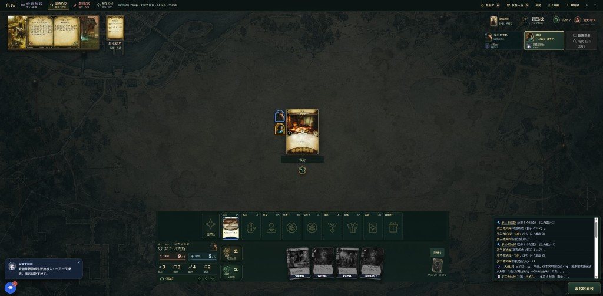

# 诡镇奇谈：卡牌版（arkhamhorror）

[桌游大厅](../../README.md) 的合作卡牌 Mod，实现《诡镇奇谈：卡牌版》（Arkham Horror: The Card Game）的规则引擎、战役内容、AI 队友和浏览器牌桌。玩家与 0~3 名 AI 队友一起扮演调查员，合作完成战役。



本目录是独立的 git 仓库（[boardgame-arkhamhorror](https://github.com/Dr-Liao/boardgame-arkhamhorror)），以子模块形式挂在大厅仓库 [boardgame-hall-ai](https://github.com/Dr-Liao/boardgame-hall-ai) 的 `games/arkhamhorror`，需要放在大厅内运行。

## 致敬

本项目深受 [halogenandtoast/ArkhamHorror](https://github.com/halogenandtoast/ArkhamHorror) 的启发，并以它作为主要参考。那是一个非官方、严格遵循规则的浏览器版《诡镇奇谈：卡牌版》（Haskell 后端 + Vue 前端，在线版本见 [arkhamhorror.app](https://arkhamhorror.app)），多年来积累了极其完整的卡牌与剧本实现。

我们从中参考的内容包括：

- 结构化卡牌数据（英文主表与简中、繁中卡表），作为本项目卡牌目录的导入来源；
- Haskell 源码中的卡牌定义与行为实现，用于核对规则细节；
- 卡图的解析与回退规则。

参考源在本地以只读方式保存，不做修补；卡牌字段的来源记录在 `catalog/provenance.json`。参考项目没有声明图片再分发许可，因此本项目只沿用卡图的解析规则，卡背等通用图片改用文字或 CSS 回退。

感谢 halogenandtoast 及所有贡献者的长期投入。

## 玩法

- **战役**：《夜之狂热》（3 关）、《敦威治遗产》（8 章）、《卡尔克萨之路》（8 章）和《失落的时代》（10 章）都可以从大厅启动。失落的时代按 M5 入口开放（`playable`，账本仍是 `earlyAccess`）：序幕会先选远征求领队并按人数购买补给品，幕间与补给点按卡面划掉配给、药品与汽油。逐张卡面字面核对仍在 `audit/tfa-migration.json` 的 `remaining` 清单中跟踪。各扩展的详细进度见下方「扩展包实现进度」。
- **调查员与构筑**：从各职业调查员中选择角色，可手动构筑或自动构筑。AI 队友会自动分配调查员并按属性契合度组出合法牌组。
- **回合循环**：神话阶段 → 调查阶段（每位调查员 3 个行动）→ 敌人阶段 → 重整阶段。
- **核心行动**：移动、调查（收集线索推进「幕」）、攻击、躲避、打出卡牌、使用资产能力；技能检定从混乱袋抽取标记。
- **跨关成长**：关卡结算后进入关间，处理经验、创伤、战役记录和卡组升级，再进入下一关。

规则采用本 Mod 的简化实现边界，未实现的机制默认阻断而不是近似放行。

## 扩展包实现进度

基础内容为核心包与《夜之狂热》。扩展按大循环迁移，每个循环拆成战役内容、调查员、玩家卡三个内容包，按 [迁移流程](docs/arkham-content-migration.md) 的 M0（目录基线）→ M1（调查员）→ M2（玩家卡）→ M3（剧本）→ M4（关键词与规则书）→ M5（发布验收）推进。包状态含义：`catalog-only` 只登记目录、不可选用；`verified` 已逐卡验收；`playable` 已开放到大厅。

| 循环 | 战役 | 战役内容 | 调查员 | 玩家卡 | 阶段 |
| --- | --- | --- | --- | --- | --- |
| 敦威治遗产 | 8 章，可启动 | 221 张，`playable` | 5 位（15 张），`verified` | 94 张，`playable` | 已发布 |
| 卡尔克萨之路 | 8 章，可启动 | 215 张，`playable` | 6 位（19 张），`verified` | 95 张，`verified` | M5 收尾 |
| 失落的时代 | 10 章，可启动（earlyAccess） | 231 张，`playable` | 5 位（16 张），`verified` | 91 / 91 张，`development` | M5 入口开放，逐卡核对进行中 |

- **敦威治遗产**：八关的布置、结算、地点、敌人、遭遇与混乱标记规则均已接入，可以从大厅打通整条战役（包括开局二选一与祭坛后的分支）。五位调查员的能力、构筑、专属卡和专属弱点已接入。玩家卡已全部逐卡验收，其中 91 张可以构筑。另有一个「支援卡试点」包（实验室助理、奇异溶液、澄明心智），奇异溶液的升级依赖战役研究记录。
- **卡尔克萨之路**：原版循环已逐卡验收，战役已开放启动。六位调查员的能力、构筑、专属卡、专属弱点和存档回放都已通过逐人验收；玩家卡和基础弱点的主要印刷效果已逐卡验收，其中 92 张可以构筑。还差 M5 的大厅、联机与浏览器端到端认证。
- **失落的时代**：M3 与 M4 已完成，M5 已开放入口。十个章节（荒莽密林、埃兹特里的覆灭、命运之线、界限彼端、久远腹地上下两半、天机之城、幽嘶深渊、破碎永世、时间倒流）都有独立的 `definition.js` / `layout.js` / `behavior.js`：布置与放在一边区、幕与议程、地点符号连线、遭遇牌堆组成、混乱标记表、结局与跨章记录，并逐章接入七项循环机制（探索牌库、检查补给、复仇、伊格之怒、中毒、古代遗物、领队）。剧情正文由 `tools/import-tfa-story.mjs` 从锁定的中文来源生成，包含序章、十章导入、全部结局、五个幕间与尾声，运行时只投影已经到达的分支并按座位过滤私密段落。八个关键词（探索、复仇、伊格之怒、补给、中毒、古代遗物、远征领队、旧神标记）已逐项验收，规则书新增九条失落的时代条目（战役与记录、探索牌库、补给与检查补给、复仇与伊格之怒、中毒、古代遗物与领队、时间线与年代、深度等级、混乱符号），带拼音索引、卡文直达与桌面／移动端浏览器用例。五位调查员（里奥·安德森、厄休拉·唐斯、芬恩·爱德华兹、马泰奥神父、加尔文·怀特）与他们 11 张专属卡、91 张玩家卡均已逐卡验收。补给链路已接通：序幕按人数发放补给品点数（1/2/3/4 人 → 每人 10/7/5/4 点）并逐位购买，补给点提供第二次购买（8/5/4/3 点），幕间按卡面共同划掉等于人数的配给、用药品移除牌组里的中毒弱点、划掉汽油，清单显示在大厅的「补给品」页签与牌桌战役面板。五个幕间与补给点也按卡面顺序结算：毛毯、放哨者（双筒望远镜额外 2 XP）、配给不足（下一场起始资源 -3）、汽油与粉笔（没有则下一场不能换牌）、地图（「摸清前进的道路」）、水壶（下一场起始线索 +1）、伊塔卡的信念、归位程式反作用（离体体验与伊斯人身体）、恢复意识、火盆、遗物读数，以及补给点用 3 XP 治中毒 / 5 XP 治 1 点创伤。48 条战役记录都有中文名，幕间正文只把实际到达的段落写进「调查纪事」，局外面板还会显示一张「幕间纪事」羊皮纸卡。牌桌的战役面板显示复仇合计、伊格之怒、当前深度、石柱、漆黑、探索牌库剩余与古代遗物位置；牌堆里混入的核心盒遭遇卡（01163–01178 共 11 种）与 04259／04261 也已逐条实现，攻击／躲避型玩家卡能力不再引发借机攻击，4 张快速卡不再白花行动，「检定 A 或 B」由玩家选择技能。账本仍是 `earlyAccess`：章节的 `literalCardBehavior` 与浏览器验收尚未完成（逐章简化分支登记在 `audit/tfa-scenario-acceptance.json` 的 `gaps`），因此不宣称规则等价。

目前扩展玩家卡共有 272 张进入构筑池（敦威治与卡尔克萨 186 张 + 失落的时代 86 张）。以上数字以 `content/registered.js` 注册表为准，调整包状态或开放卡牌后应同步更新本节。

## AI 队友

诡镇是大厅里合作类 Mod 的完整示例：

- 一个调查员每回合有 3 个行动点，AI 在同一回合内的多步决策共享对话历史（回合内记忆）。
- AI 只能看到自己座位的观察投影，读不到其他人的手牌、牌库顺序或未触发的剧情。
- 模型不可用时，兜底行动以对局随机数状态为种子，同一局可复现。
- 战术交流、备忘等功能由大厅提供，详见 [大厅 README](../../README.md#战术交流与备忘)。

## 安装

本 Mod 不能单独运行，需要通过大厅仓库拉取：

```bash
git clone --recursive https://github.com/Dr-Liao/boardgame-hall-ai.git
cd boardgame-hall-ai
npm install
```

已经克隆过大厅的话，在大厅根目录运行 `git submodule update --init` 再 `npm install`。

卡图约 1.9 GB，不在仓库中。首次显示时会自动缓存，也可以在本目录运行 `npm run images:fetch` 一次性下载（`npm run images:estimate` 预估大小，`npm run images:verify` 校验）。

Windows 发布时，卡图单独打成资源包：在大厅根目录双击 `build-windows-assets.bat` 或运行 `npm run build:windows:assets`。

## 测试

在大厅根目录运行：

```bash
npm run test:mod -- arkhamhorror fast     # 日常回归：规则、AI、卡牌逻辑、golden replay，约 17 秒
npm run test:mod -- arkhamhorror assets   # 资源与生成器校验：卡池导入、展示资源、媒体许可，约 30 秒
npm run test:mod -- arkhamhorror slow     # 长跑：整局模拟、存读档迁移、100 局随机对局重放与大厅联机集成，约 2 分钟以上
npm run test:mod -- arkhamhorror          # 全量：每个文件独立进程并行，约 2.5 分钟
npm run test:mod -- arkhamhorror browser  # 浏览器回归，含大厅开局与联机界面（复用系统 Edge）
```

改卡行为后要证明"行为零变化"：`node tools/replay-fixtures.mjs --baseline <文件>`（改动前）→ 改 → `--compare <文件>`（改动后）；
只改了文案/卡图等非行为内容时，`npm run replay:fixtures` 应当仍然全绿。说明见 [docs/phase4-replay.md](docs/phase4-replay.md)。

诡镇在大厅上的集成回归（多人联机、换牌确认、开局与存档界面）在 `tests/hall-online.test.mjs`、`tests/hall-online.browser.mjs` 与 `tests/hall-setup.browser.mjs`；大厅自身的回归不再依赖诡镇。

免安装包的卡图资源包由 `boardgame-mod.json` 的 `assetPacks` 声明，`tools/prepack-release.mjs --asset-pack=arkham-cards` 为它生成卡图清单；使用说明里的诡镇条目来自 `portableNotes`。

改动规则、默认值或 AI 时先跑 `fast`，只改卡牌数据或素材时再跑 `assets`。分层清单在 `tests/suites.mjs`，新增用例必须声明所属层级，否则守卫用例会报错。

HTTP 和浏览器回归会加载大厅的 `lib/server.js`，所以需要在大厅目录内运行。其中包含「同一种子产生相同 AI 决策序列」的复现性断言。更多说明见 [测试说明](../../docs/testing.md)。

## 文档

- [ARCHITECTURE.md](ARCHITECTURE.md)：目录职责、依赖方向、运行流程、内容扩展和修改约定（含演进规矩摘要）
- [docs/architecture-refactor-roadmap.md](docs/architecture-refactor-roadmap.md)：重构路线唯一决策文档——现状基线、分层硬规矩、加卡指南、表达力缺口、阶段门禁与迁移判据
- [docs/card-model.md](docs/card-model.md)：卡牌模型 v1——十一种能力 kind、修正与条件、目标枚举、持续效果、生命周期读点契约、迁移标准动作
- [docs/phase2-primitives.md](docs/phase2-primitives.md)：Phase 2 语义原语的交付与门禁证据（费用/上限/检定结果/看牌/区域搬运等）
- [docs/phase4-replay.md](docs/phase4-replay.md)：Phase 4 重放安全网——动作日志、稳定指纹、golden replay、迁移前后指纹对比、随机走子器门禁
- [docs/arkham-content-migration.md](docs/arkham-content-migration.md)：扩展战役的迁移流程与验收门槛（含实现规矩）
- 大厅侧的适配入口：`index.js`、`src/integration/hall-integration.js`、`src/ai/agent-plans.js`

## 版权声明

本应用中关于[《诡镇奇谈：卡牌版》（Arkham Horror: The Card Game™）][arkham]的信息，包括文字与图像，版权归 © Fantasy Flight Games 所有。本项目是非官方的粉丝作品，并非由 Fantasy Flight Games 制作，也未获得其认可或支持，与其没有任何关联。

所有美术作品与插画的知识产权归各自的创作者所有。《诡镇奇谈：卡牌版》的全部图像与图形版权归 Fantasy Flight Games 所有。"Arkham Horror" 及相关名称、标志是其各自权利人的商标。

### Copyright Disclaimer

The information presented in this app about [Arkham Horror: The Card Game™][arkham], both textual and graphical, is © Fantasy Flight Games. This app is a fan project and is not produced, endorsed, or supported by, or affiliated with Fantasy Flight Games.

All artwork and illustrations are the intellectual property of their respective creators. All Arkham Horror: The Card Game™ images and graphics are copyrighted by Fantasy Flight Games.

[arkham]: https://www.fantasyflightgames.com/en/products/arkham-horror-the-card-game/
